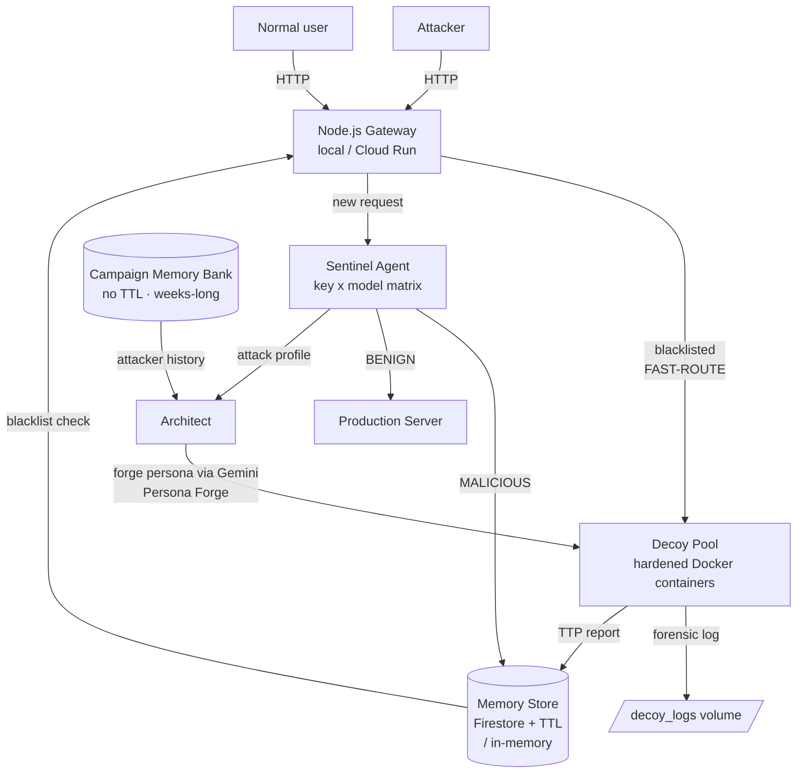

# MIRAGE-NODE

**Agentic Deception Gateway** — a turn-the-tables gate for attackers: normal traffic flows through to the real production server, while attacks are analyzed by AI agents and the attacker is silently diverted into a *honeypot whose personality is forged to match their target* — every payload they send is captured as threat intelligence (TTP evidence).

> Built for the **All Things Agentic Hackathon (Google)** — track **The Fortified Enterprise Fleet**.
> *"Judges reward agents that take action, not agents that talk well."* — and these agents truly act.

---

## The Problem We Solve

Traditional IDS/WAFs only **reject** attacks (block/drop). Knowledge about *who*, *how*, and *what exactly* the attacker tried is thrown away. MIRAGE-NODE flips the game:

1. **Sentinel** (Gemini classification agent) scores every request with strict structured output (`MALICIOUS|BENIGN` enum + attack type + confidence).
2. Offenders enter a **persistent TTL-bounded blacklist** (Firestore in the cloud; in-memory locally) — their next requests never touch the LLM again (*fast-route*).
3. **Architect** selects & launches a decoy container matching the attack target (`wordpress` / `api` / `generic`) inside a hardened sandbox — while **Persona Forge** has Gemini forge a unique fictional server persona for it.
4. **P4 — Persona per-Fingerprint:** before spawning, the gateway reads the attacker's *Campaign Memory* and hands it to the Forge, so a repeat offender meets a decoy crafted around their own history.
5. The attacker "succeeds" against the decoy — while every payload, header, and technique lands in **Threat Intel** as forensic evidence.

## Architecture



### Fortified Enterprise Fleet — requirement mapping

| Track requirement | Where it lives |
|---|---|
| Agents **cataloged for cross-department use** | `GET /_mirage/agents` — self-describing catalog (`version` / `department` / `owner` per agent, `departmentsServed`, GEAP vocabulary mapping) |
| **Context across weeks of async operations** | Campaign Memory Bank (`src/lib/campaign_memory.js`) — intentionally no-TTL aggregates keyed by fingerprint hash; hydrated from Firestore at boot so the ledger survives instance restarts (proven across processes by `tests/integration_check.js [MEMORY-BANK]`) |
| Production data without violating **compliance / sovereignty / security** | Hash-only fingerprints (never raw PII), bounded aggregates (≤8 attack types, ≤5 IP samples), regional dataset (asia-southeast2), credentials via Secret Manager with per-secret least-privilege grants, `.env` excluded from images via `.gcloudignore` |

### Gemini usage — key × model matrix (P4.5)

Gemini quotas are **per-model per project**. The gateway therefore builds every usable *(credential × model)* combo — key-major — and fails over automatically:

```
K1 x gemini-3.5-flash → K1 x gemini-3.6-flash → K1 x gemini-3.7-flash → K2 x ... 
```

- `429 / RESOURCE_EXHAUSTED` ⇒ that combo cools down for `MODEL_COOLDOWN_MS`.
- Dead key (`400 API key not valid`) ⇒ its whole column is dropped.
- Unknown model (`404`) ⇒ skipped permanently.
- If the entire matrix exhausts, Sentinel degrades to deterministic local heuristics — the pipeline never breaks (proven live).

## Running Locally

Prerequisites: Node ≥ 20, Docker Desktop running (for decoys), a Gemini key.

```bash
# 1. Credentials
cp .env.example .env          # fill GEMINI_API_KEY (+ optional GEMINI_API_KEY_2)

# 2. Verify the AI path
npm run smoke                 # expect PASS (PONG)

# 3. Terminal 1 - real production server (port 3000)
npm run start:prod

# 4. Terminal 2 - gateway (port 8888; builds the honeypot image on first decoy)
npm start

# 5. Terminal 3 - wargame: benign hit + SQLi + fast-route
npm test
```

Expected: payload `admin' OR 1=1 --` is scored MALICIOUS, the IP is blacklisted, the next request diverts without an LLM call, and the persona forge logs `New persona cached for '...', history-adapted`. Payloads land in `decoy_logs/attacker_payloads.jsonl` and `threat_intel.local.jsonl`.

### Environment variables (.env)

See **`.env.example`** for the full annotated template. Highlights:

| Variable | Default | Purpose |
|---|---|---|
| `GEMINI_API_KEY` / `GEMINI_API_KEY_2` | — | Credentials for the failover matrix |
| `GEMINI_MODEL` | `gemini-3.5-flash` | Primary model (leads the chain) |
| `GEMINI_MODEL_CHAIN` | `gemini-3.6-flash,gemini-3.7-flash` | Failover models after the primary |
| `MODEL_COOLDOWN_MS` | `60000` | Cooldown for an exhausted combo |
| `LATENCY_MODE` | `sync` | `sync` = fail-closed; `async` = proxy now, verify later |
| `BLACKLIST_TTL_HOURS` | `24` | Blacklist lifetime (fairness on shared NAT) |
| `PERSONA_*` | see template | Persona Forge switches & bounds |
| `DASHBOARD_TOKEN` | empty | Protects `/_mirage/dashboard` & `/_mirage/intel` |
| `FIRESTORE_PROJECT_ID` | — | Enables Firestore (auto on Cloud Run) |

Dashboard: **`/_mirage/dashboard`** — a campaign-ledger console (tally marks = days known). Auto-refreshes every 5 s from `/_mirage/intel`.

## Deploying to Google Cloud

```bash
gcloud auth login
GOOGLE_CLOUD_PROJECT=<your-project-id> bash deploy_cloudrun.sh
```

The script enables APIs (Run/Firestore/Cloud Build/Secret Manager), creates a regional Firestore database, attempts the blacklist TTL policy, builds via Cloud Build, and deploys to Cloud Run. Honest architecture note: dynamic decoy-spawning requires a Docker daemon, so on Cloud Run the gateway automatically *degrades gracefully* (Sentinel + matrix + blacklist + threat-intel + memory bank remain full; no spawn) — intentional and documented.

Live deployment used during development: `https://mirage-gateway-<project-number>.asia-southeast2.run.app`

## Security Hardening

- Decoy sandbox: `--cap-drop=ALL --security-opt=no-new-privileges --read-only --memory=128m --cpus=0.5 --tmpfs(noexec)` + isolated `honeynet` network
- Decoys run non-root (`node:20-alpine`) with HEALTHCHECK; TTL reaper kills leaks; clean shutdown drains all decoys
- Docker operations are async & shell-free (`execFile`) — one attack can never freeze the gateway
- **Persona output is treated as untrusted data**: strict local validator (anti CRLF/response-splitting, RFC-token header names ≤6, integer status 200–599, pure-data body with bounded depth/size); any forge failure falls back to the stock persona — pipeline untouched
- **Anti economic-DoS**: per-IP rate limit for LLM-bound requests + verdict cache for identical payloads
- **Prompt-injection fencing** everywhere: `<PAYLOAD>` / `<PROFILE>` / `<ATTACKER_HISTORY>` blocks are DATA, system instructions are non-negotiable, outputs are schema-enforced enums
- Proxy-aware client IP (X-Forwarded-For only behind trusted proxies); IPv4-mapped-IPv6 normalization
- Infrastructure errors ≠ attacks → degraded heuristic mode instead of mass blacklisting
- Credential hygiene: secrets only via Secret Manager with per-secret Accessor grants; `.env` blocked from git/images by `.gitignore` + `.dockerignore` + `.gcloudignore`; `scripts/secret_scan.js` gates every commit
- Full English codebase & logs (hackathon language requirement)

## Testing

| Command | What it proves |
|---|---|
| `npm run test:unit` | 51 fast cases (no LLM/Docker): IP normalization, profiles, heuristics, fingerprinting, persona validator, trace store, campaign memory (incl. restart simulation), model matrix classifiers |
| `npm run test:integration` | 7 gates: double boot, agent registry, pre-scan, fast-route, token auth, **Memory Bank read back by a different process** |
| `npm run smoke` | End-to-end Gemini transport (PONG) |
| `npm run verify:sentinel` | Live classification harness: SQLi / path-traversal / normal user |
| `node tests/persona_history_e2e.js` | **P4 proof**: same-client SQLi twice → forge logs a `history-adapted` LLM persona |
| `npm test` | E2E wargame against a running gateway |
| `tests/*_probe.js` | Transport/auth forensic tools kept as engineering documentation |
| `npm run clean` | Remove runtime artifacts (logs, snapshots) |

## Roadmap

See **`implementation_plan.md`** for the living blueprint. Done: fingerprinting, LLM-forged personas (+history adaptation), campaign memory bank, agent catalog manifest, quota-aware model matrix, observability traces, English everything. Pending: full GEAP registry feed, OpenTelemetry export, JA3/JA4 TLS fingerprints, persona persistence tuning.

## License

ISC — see `LICENSE`.
